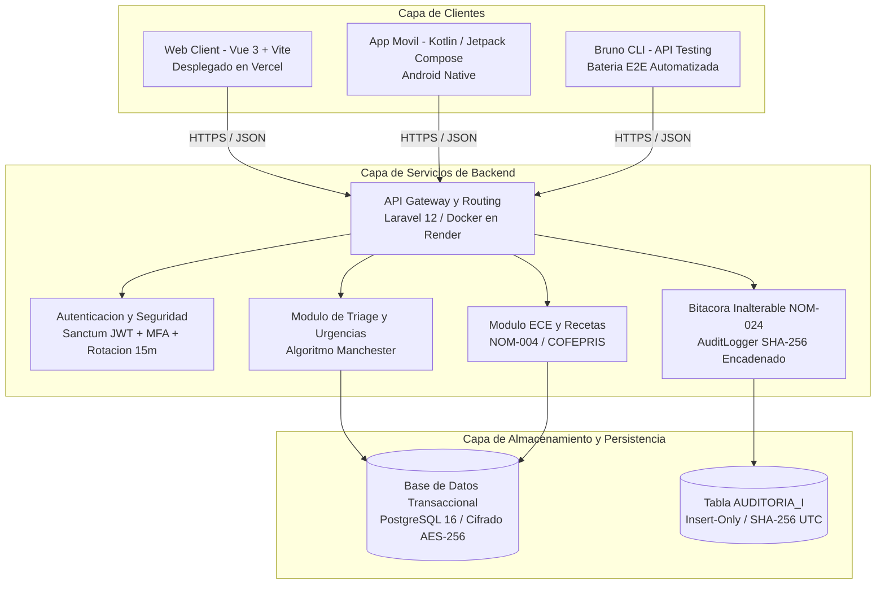
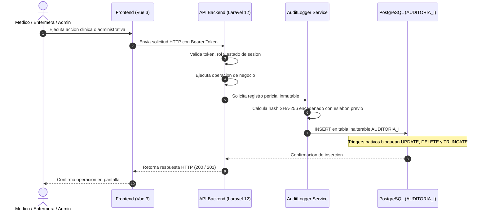
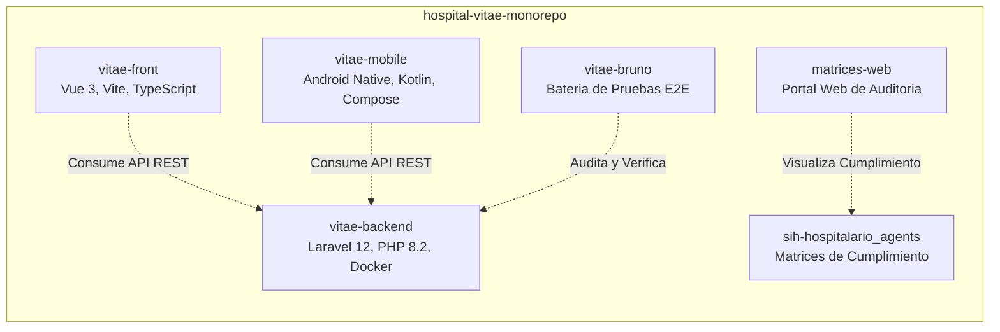

# Hospital Vitae - Monorepo

[](https://laravel.com)
[](https://vuejs.org)
[](https://vitejs.dev)
[](https://developer.android.com)
[](https://vercel.com)
[](https://render.com)

Monorepo del Sistema de Informacion Hospitalaria (SIH) del **Hospital Vitae**, disenado y desarrollado bajo lineamientos estrictos de **Auditoria de Software, Trazabilidad Forense e Interoperabilidad Clinica**. Integra el backend de servicios RESTful, la plataforma web clinica y administrativa, la aplicacion movil nativa, colecciones de pruebas E2E automatizadas y matrices de cumplimiento normativo.

---

## Marco Normativo y Cumplimiento

El diseno, arquitectura y modelo de datos del sistema operan en apego riguroso a las normas oficiales y estandares internacionales de salud y ciberseguridad:

| Norma / Estandar | Alcance en el Sistema | Implementacion Tecnica |
| :--- | :--- | :--- |
| **NOM-024-SSA3-2012** | Sistemas de Informacion de Registro Electronico para la Salud (SIRES) | Bitacora inalterable `AUDITORIA_I` de 13 columnas, encadenamiento criptografico SHA-256 en UTC, disparadores nativos anti-modificacion (bloqueo de UPDATE, DELETE y TRUNCATE). |
| **NOM-004-SSA3-2012** | Expediente Clinico Electronico (ECE) | Retencion documental de 5 anos (1825 dias), prohibicion de borrado fisico, seguimiento de fecha de ultimo acto medico, sellado de notas clinicas post-firma. |
| **NOM-206-SSA1-2002** | Criterios de atencion en servicios de urgencias y Triage | Algoritmo Manchester de 5 niveles deterministico, evaluacion forzada de paciente inconsciente a Rojo, gestion de SLAs y distribucion de salas de emergencia. |
| **ISO/IEC 27001** | Gestion de la Seguridad de la Informacion | Cifrado AES-256-GCM para adjuntos clinicos, TLS >= 1.2 forzado hacia base de datos, encabezados HSTS (31.5M s), CSP estricto, rotacion de JWT (15 min) y estrategia de respaldos 3-2-1. |
| **ISO/IEC 25010** | Calidad de Software y Alta Disponibilidad | Orquestacion Docker con limites de recursos, resiliencia con replicas >= 2, monitoreo continuo de salud en `/up` y `/api/v1/salud`. |
| **LFPDPPP** | Proteccion de Datos Personales en Posesion de Particulares | Disociacion total de datos personales (PII) en monitores publicos de sala de espera, datos sinteticos para pruebas y registro auditado de eventos de acceso. |
| **HL7 FHIR R4** | Interoperabilidad Semantica en Salud | Esquemas y recursos estandarizados (`Patient`, `Encounter`, `Observation`, `MedicationRequest`). |
| **COFEPRIS / SAT** | Receta Medica Electronica y Medicamentos Controlados | Folios unicos institucionales, validacion de cedula profesional medica, sellado digital SHA-256 y codigo QR verificable. |

---

## Diagramas de Arquitectura y Flujos

### 1. Arquitectura General del Sistema



---

### 2. Flujo de Trazabilidad e Inalterabilidad Pericial (NOM-024)



---

### 3. Componentes del Monorepo



---

## Estructura de Directorios

```text
hospital-vitae-monorepo/
|-- README.md                    # Documentacion general del sistema
|-- AGENTS.md                    # Reglas criticas de desarrollo, control de versiones y convenciones Git
|-- .agents/                     # Reglas de agentes y matrices de cumplimiento
|-- docs/                        # Recursos de diseno y diagramas del sistema
|-- matrices-web/                # Portal web estatico interactivo para matrices normativas
|-- sih-hospitalario_agents/     # Documentacion de auditoria, matriz de cumplimiento y trazabilidad
|-- vitae-backend/               # API RESTful en Laravel 12 (PHP 8.2+) endurecida con Docker
|-- vitae-front/                 # Aplicacion Web clinica en Vue 3 + Vite + TypeScript
|-- vitae-mobile/                # Aplicacion movil nativa Android en Kotlin
`-- vitae-bruno/                 # Coleccion Bruno de pruebas automatizadas y script de ejecucion
```

---

## Componentes del Proyecto

### 1. Backend (`vitae-backend`)
Nucleo transaccional del sistema, encargado de la logica de negocio, validaciones biologicas, gestion de urgencias y bitacora forense.
* **Tecnologias:** PHP 8.2+, Laravel 12, PostgreSQL 16 / SQLite, Docker endurecido (`www-data`, puerto 8080/10000).
* **Despliegue:** Desplegado en [Render](https://render.com/) mediante contenedor Docker optimizado.
* **Servidor en Produccion:** `https://auditoria-backend-u47a.onrender.com/api/v1`
* **Healthcheck:** `https://auditoria-backend-u47a.onrender.com/up`

#### Configuracion Local:
```bash
cd vitae-backend
composer install
cp .env.example .env
php artisan key:generate
php artisan migrate --seed
php artisan serve
```

#### Ejecucion de Pruebas Backend:
```bash
cd vitae-backend
php artisan test
```

---

### 2. Frontend Web (`vitae-front`)
Plataforma clinica y administrativa modularizada con ergonomia WCAG 2.1 AA y navegacion por roles.
* **Tecnologias:** Vue 3 (Composition API / Script Setup), Vite, TypeScript, Vue Router, Axios.
* **Roles Implementados:**
  * **Medico:** Espacio ECE, notas clinicas, emision de recetas, solicitud de estudios y gestion de cola.
  * **Enfermeria:** Box de triage, evaluacion Manchester, reclasificacion y monitoreo de sala.
  * **Recepcion:** Busqueda fonetica / RENAPO de CURP, registro de expedientes, agendamiento de citas y censo de camas.
  * **Administracion:** Gestion de usuarios, desbloqueo de cuentas, monitoreo Docker y consulta de bitacora inalterable.
  * **Laboratorista:** Banco de estudios, captura y validacion de resultados y registro de rechazos de muestra.
* **Despliegue:** Configurado para [Vercel](https://vercel.com/).

#### Comandos de Validacion:
```bash
cd vitae-front
npm install
npm run dev           # Servidor local de desarrollo
npm run type-check    # Comprobacion estricta de tipos TypeScript (vue-tsc)
npm run test          # Pruebas unitarias de sesion y autenticacion
npm run build-only    # Compilacion optimizada para produccion
```

---

### 3. Aplicacion Movil (`vitae-mobile`)
Cliente nativo Android para el acceso de pacientes y consulta de citas y recetas.
* **Tecnologias:** Kotlin, Jetpack Compose, Material 3, Android SDK 35, Gradle KTS.

#### Compilacion:
* Abrir el directorio `vitae-mobile` en **Android Studio Ladybug** o superior.
* Sincronizar dependencias mediante Gradle y ejecutar en dispositivo fisico o emulador.

---

### 4. Bateria de Pruebas Automatizadas Bruno (`vitae-bruno`)
Coleccion de pruebas estructuradas E2E para auditar en tiempo real los endpoints del sistema.
* **Herramienta:** [Bruno API Client / Bruno CLI](https://www.usebruno.com/).
* **Suites Implementadas:**
  * `01-Auth`: Autenticacion, JWT, MFA, refresco de token y mitigacion de enumeracion (HTTP 401).
  * `02-Usuarios`: Paginacion, alta medica con validacion de cedula, bajas logicas y reactivaciones.
  * `03-Seguridad-RBAC`: Control estricto de accesos no autorizados (HTTP 401 y 403).
  * `04-Logout`: Revocacion segura de tokens activos.
  * `05-Auditoria-I`: Consulta de bitacora inalterable, filtros avanzados y rechazo de metodos de escritura (HTTP 405).
  * `06-Infraestructura-y-Tiempo`: Sincronizacion horaria CENAM/NTP y estado de salud de subsistemas.
  * `07-Triage-Manchester`: Algoritmo Manchester, asignacion de salas, rechazos biologicos (HTTP 422), reclasificaciones medicas, colas vivas, admisiones NN y monitores publicos disociados.

#### Ejecucion Automatizada de Pruebas en Produccion:
```powershell
cd vitae-bruno
powershell -ExecutionPolicy Bypass -File ./test-prod-suite.ps1
```
El script autentica los diferentes roles en produccion, ejecuta las 7 suites en orden logico y genera un informe estructurado en `bruno_prod_results.log`.

---

## Estado de Sprints

* **Sprint 1 (Base y Autenticacion):** Completado. Estructura de monorepo, autenticacion centralizada Sanctum JWT y modelos base.
* **Sprint 2 (Infraestructura y Auditoria Inalterable):** Completado. Endurecimiento Docker, sincronizacion NTP, bitacora inalterable `AUDITORIA_I` de 13 columnas y respaldos 3-2-1 cifrados.
* **Sprint 3 (Triage Manchester y Urgencias):** Completado. Algoritmo Manchester deterministico, colas de urgencias, salas de espera disociadas, vistas de Administrador y Laboratorista.
* **Sprint 4 (ECE, Recetas Controladas y FHIR R4):** En desarrollo. Modelado de antecedentes estructurados, notas medicas inmutables, recetas con codigo QR conforme a COFEPRIS y endpoints HL7 FHIR R4.

---

## Politicas de Control de Versiones

De acuerdo con las directrices centrales de desarrollo del proyecto:
1. **Rama `main` protegida:** Prohibido realizar commits directos a `main`. Unicamente recibe releases auditados integrados desde `dev`.
2. **Rama `dev` como base:** Todas las ramas de trabajo derivan de `dev` (`feature/*`, `bugfix/*`, `refactor/*`, `test/*`, `chore/*`).
3. **Formato de Commits (Conventional Commits):** `<tipo>(<alcance>): <descripcion en imperativo>` acompanado de referencias a tareas y normativas (`Refs: #TASK-ID, Audit: AI-0X`).
4. **Seguridad y Cero Secretos:** Prohibido incluir credenciales, llaves privadas o datos personales reales en el repositorio.

---

## Creditos y Licencia

Proyecto academico y de investigacion desarrollado para la asignatura de **Auditoria de Software (9no Semestre)**.
* **Repositorio oficial:** [github.com/Coria322/hospital-vitae-monorepo](https://github.com/Coria322/hospital-vitae-monorepo)
