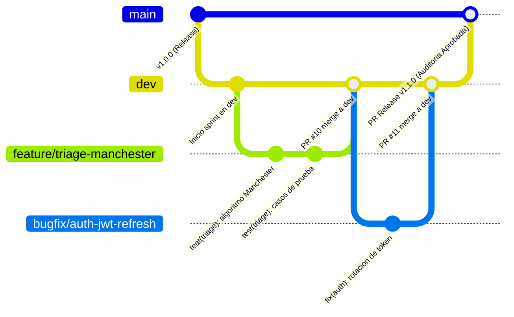

# AGENTS.md — SIH Hospital Vitae (Gobernanza General del Proyecto)

> Documento Maestro de Lineamientos, Reglas de Agentes y Control de Cambios.
> Aplica para todo el ecosistema: `vitae-backend`, `vitae-front`, `vitae-mobile` y `vitae-bruno`.

---

## 1. REGLAS GLOBALES Y OBLIGATORIAS DE AGENTES

### 📌 Regla de Fin de Sprint / Feature y Commits
1. **Verificación de Pruebas Obligatoria:** NO realizar commit si no se ha pasado previamente por el 100% de las pruebas automatizadas (PHPUnit, Jest/Vitest, Bruno CLI, según aplique).
2. **Autorización Previa:** SIEMPRE solicitar autorización expresa del usuario antes de realizar cualquier commit.
3. **Mapa de Trabajo:** Al solicitar autorización, generar y presentar un mapa detallado y estructurado de todo lo construido o modificado.
4. **Recordatorio de Commit:** Al terminar un sprint o feature, recordar inmediatamente al usuario realizar el commit antes de iniciar cualquier nueva tarea o feature.

### 📌 Regla de Mantenimiento de la Matriz de Trazabilidad
- Al concluir cada Sprint o Feature, el agente DEBE actualizar obligatoriamente el archivo [`matriz_trazabilidad.md`](./matriz_trazabilidad.md).
- **Indicación de Tachado:** Todo requerimiento funcional (RF), no funcional (RNF) o norma cumplida DEBE tacharse visualmente mediante sintaxis markdown (`~~RF-XXX~~: ~~Descripción~~~`) y marcarse con el indicador `✅ Cumplido (Sprint N)`.
- Ningún Sprint puede declararse cerrado sin haber aplicado el tachado y validado la correspondencia con los criterios de aceptación y normas del ERS.

---

## 2. ESTRATEGIA Y FLUJO DE TRABAJO GIT

### 🔀 Modelo de Ramas y Políticas de Integración
```
feature/TASK-XXX  ──(Pull Request / Merge)──>  dev (develop)  ──(Git Rebase)──>  main (producción)
```

1. **Ramas Feature:**
   - Todo desarrollo parte de `dev` con el formato `feature/<nombre-feature>` o `fix/<nombre-fix>`.
2. **Integración en Dev (`merge`):**
   - El **`merge`** va **ÚNICAMENTE hacia la rama `dev`** (mediante Pull Request y revisión por pares).
   - En `dev` se integra, valida y despliegan los ambientes de pruebas locales y staging.
3. **Integración en Main (`rebase`):**
   - **`main` SE REBASARÁ (`git rebase`), NUNCA SE HARÁ `merge` DIRECTO A `main`.**
   - Para llevar cambios a producción:
     ```bash
     git checkout main
     git fetch origin
     git rebase dev
     git push origin main
     ```
   - Esto garantiza un historial completamente lineal, sin commits de merge huérfanos en la rama productiva, facilitando auditorías forenses y bisecciones (`git bisect`).

### 📝 Estándar de Commits (Conventional Commits)
Formato estricto:
```
<tipo>(<alcance>): <descripción imperativa en español>

[cuerpo explicativo opcional]

Refs: #TASK-W-XXX, Req: RF-XXX, Audit: AI-XX
```
- **Tipos permitidos:** `feat`, `fix`, `docs`, `style`, `refactor`, `test`, `chore`.
- **Ejemplo:**
  ```text
  feat(auth): implementar endpoints y rbac para sprint 1 (AI-01)

  - Creada tabla usuario con id_usuario VARCHAR(10) y soporte Bcrypt cost 12
  - Configurados middlewares VerifyAccountStatus y RoleAuthorization
  - Creada suite de pruebas en Bruno CLI (13 requests) y PHPUnit (8 tests)

  Refs: #TASK-W-004, #TASK-W-005, Req: RF-001, RF-002, Audit: AI-01
  ```

---

## 3. ARQUITECTURA Y ESTÁNDARES TÉCNICOS

### Stack Oficial
- **Backend:** Laravel 11 (LTS), API REST bajo prefijo `/api/v1`, Laravel Sanctum (Tokens Bearer).
- **Base de Datos:** PostgreSQL 15+ (Supabase) con esquema `public` endurecido.
- **Frontend Web:** Vue.js (SFC, MVVM), Vite, Pinia.
- **App Móvil:** Android Nativo (Kotlin, Jetpack Compose, minSdk 29).
- **Pruebas de API:** Bruno CLI (`bru run`) y Bruno Desktop v4 (formato OpenCollection `.yml` y legacy `.bru`).

### Invariantes de Seguridad y Normatividad
- **NOM-004-SSA3-2012:** Prohibido el `DELETE` físico en registros clínicos y usuarios (`baja` lógica con `estado_cuenta = 'BAJA'`). Retención mínima de 5 años.
- **NOM-024-SSA3-2012:** Trazabilidad absoluta en `AUDITORIA_I` inalterable con encadenamiento SHA-256.
- **NOM-206-SSA1-2002:** Triage Manchester de 5 niveles con alertas de SLA estrictas.
- **ISO/IEC 27001 & OWASP ASVS L2:**
  - Contraseñas con factor de costo Bcrypt >= 12.
  - Respuestas HTTP estándar: `401 Unauthorized` (falta sesión o token inválido) vs `403 Forbidden` (rol sin privilegios suficientes).
  - Bloqueo de cuenta tras 3 intentos fallidos de inicio de sesión en ventana de 60 minutos.
  - Secretos y variables maestras exclusivamente en `.env`.
# 📋 AGENTS.md — Directrices Generales de Gobernanza, Commits y Ramas Git

> **Proyecto:** Sistema de Información Hospitalaria (Hospital Vitae - Monorepo)  
> **Materia:** Auditoría de Software (9no Semestre)  
> **Alcance:** Monorepo General (`vitae-backend`, `vitae-front`, `vitae-mobile`, `vitae-bruno`, `sih-hospitalario_agents`)  
> **Versión:** 1.0.0  
> **Fecha de Emisión:** Octubre 2026  
> **Audiencia:** Desarrolladores, Líderes Técnicos, Auditores y Agentes Autónomos de Inteligencia Artificial  

---

## 1. POLÍTICA ESTRICTA DE RAMAS (GIT FLOW MONOREPO)

Para garantizar la estabilidad operativa del sistema clínico, la trazabilidad exigida por las normas sanitarias (**NOM-004-SSA3-2012**, **NOM-024-SSA3-2012**) y la rigurosidad académica de la auditoría de software, se establece un modelo de flujo de trabajo basado en ramas controladas.



### 1.1. Reglas Innegociables

1. 🚫 **PROHIBICIÓN TOTAL DE COMMITS DIRECTOS A `main`**:
   - **Nadie** (ningún desarrollador, líder técnico ni agente automatizado) debe hacer `git commit` o `git push` directamente sobre la rama `main`.
   - `main` está reservada exclusivamente para código en estado de producción estable, verificado, congelado y formalmente auditado.
   - Cualquier cambio a `main` debe provenir **únicamente** de un Pull Request de Release originado en `dev`.

2. 🌿 **`dev` COMO RAMA BASE DE DESARROLLO E INTEGRACIÓN**:
   - La rama central de trabajo activo, integración continua y recepción de código es **`dev`**.
   - **Toda nueva rama** debe nacer a partir de la versión más reciente de `dev`:
     ```bash
     git checkout dev
     git pull origin dev
     git checkout -b <tipo>/<alcance>-<nombre-descriptivo>
     ```
   - **Todo merge** de funcionalidades, refactorizaciones, documentación o correcciones debe tener como destino la rama **`dev`** mediante un **Pull Request (PR)**.

3. 🛡️ **PROTECCIÓN DE RAMAS Y REVISIÓN POR PARES (CODE REVIEW)**:
   - Tanto `main` como `dev` son ramas protegidas en el repositorio remoto.
   - Ninguna rama se integra sin al menos **1 aprobación** de un revisor distinto al autor del cambio.
   - Todo PR hacia `dev` debe superar satisfactoriamente las pruebas automáticas del pipeline de CI (linters, pruebas unitarias y secret-scan).

---

## 2. NOMENCLATURA DE RAMAS

Toda rama de trabajo creada en el monorepo debe seguir el siguiente patrón obligatorio:

```
<tipo-de-rama>/<alcance-o-componente>-<descripcion-corta>
```

o si está vinculada directamente a una tarea del backlog:

```
<tipo-de-rama>/<id-tarea>-<descripcion-corta>
```

### 2.1. Prefijos de Ramas Permitidos

| Prefijo | Propósito | Rama Origen | Rama Destino (Merge) | Ejemplo |
|---|---|---|---|---|
| `feature/` | Nuevas características, requerimientos o módulos clínicos | `dev` | `dev` | `feature/backend-triage-manchester`<br>`feature/TASK-W-042-captura-triage` |
| `bugfix/` | Corrección de defectos, bugs técnicos o desviaciones funcionales | `dev` | `dev` | `bugfix/mobile-session-timeout`<br>`bugfix/api-jwt-revocation` |
| `refactor/`| Reestructuración de código sin cambiar comportamiento | `dev` | `dev` | `refactor/front-store-pinia`<br>`refactor/backend-patient-repository` |
| `docs/` | Cambios en documentación, manuales, diagramas o guías de agentes | `dev` | `dev` | `docs/commit-guidelines`<br>`docs/audit-checkpoint-ai03` |
| `test/` | Adición o corrección de suites de pruebas (PHPUnit, Bruno, JUnit) | `dev` | `dev` | `test/bruno-endpoints-recetas`<br>`test/backend-triage-unit` |
| `chore/` | Tareas de mantenimiento, dependencias o herramientas de build | `dev` | `dev` | `chore/update-vue-deps`<br>`chore/docker-compose-config` |
| `hotfix/` | **Emergencia en producción:** Parche crítico que no puede esperar al sprint | `main` | `main` **Y** `dev` | `hotfix/security-xss-sanitization` |

> ⚠️ **Nota sobre `hotfix/`:** Es el único caso que se bifurca de `main`. Al resolverse, debe integrarse obligatoriamente tanto en `main` (con nuevo tag de parche SemVer) como en `dev` para evitar regresiones.

---

## 3. ESTRUCTURA Y NOMENCLATURA DE COMMITS

Los mensajes de commit deben apegarse rigurosamente a la especificación **Conventional Commits (v1.0.0)**, complementada con metadatos de trazabilidad para la **Auditoría de Software**.

### 3.1. Formato General

```
<tipo>(<alcance>): <descripción corta en modo imperativo>

[cuerpo explicativo opcional: justificación técnica y del cambio]

[pie de página / metadatos de auditoría y trazabilidad]
```

### 3.2. Catálogo de Tipos (`<tipo>`)

| Tipo | Definición | ¿Impacta Versión? |
|---|---|:---:|
| `feat` | Incorporación de una nueva funcionalidad o módulo | Minor (`x.Y.0`) |
| `fix` | Corrección de un defecto o bug en el código | Patch (`x.x.Z`) |
| `docs` | Cambios exclusivos en documentación o especificaciones | Patch (`x.x.Z`) |
| `style` | Formato, espacios en blanco, punto y coma, identación (sin cambio de lógica) | Ninguno |
| `refactor` | Cambio de código que no arregla un bug ni añade una función | Patch (`x.x.Z`) |
| `perf` | Optimización de rendimiento, tiempos de respuesta o consumo de memoria | Patch (`x.x.Z`) |
| `test` | Creación o modificación de pruebas unitarias, de integración o contratos Bruno | Ninguno |
| `build` | Modificación de dependencias (Composer, npm, Gradle), Dockerfiles o builds | Patch (`x.x.Z`) |
| `ci` | Cambios en configuración de integración/despliegue continuo (GitHub Actions, Sonar) | Ninguno |
| `chore` | Tareas auxiliares, tooling, actualización de `.gitignore` | Ninguno |

### 3.3. Alcances Permitidos (`<alcance>`)

El alcance define la zona del monorepo o el dominio clínico impactado. Debe escribirse en minúsculas:

#### A. Por Subsistema del Monorepo:
- `backend` (o `api`): Lógica de Laravel 12 en `vitae-backend/`
- `front` (o `web`): Interfaz SPA Vue 3 en `vitae-front/`
- `mobile`: Aplicación Android Kotlin en `vitae-mobile/`
- `bruno`: Colecciones de pruebas API en `vitae-bruno/`
- `db`: Esquemas, migraciones, seeds o políticas RLS en base de datos
- `infra`: Docker, servidores de despliegue, variables de entorno
- `agents`: Documentación o directrices de agentes en `sih-hospitalario_agents/`

#### B. Por Módulo Clínico / Dominio Funcional:
- `auth`: Autenticación, JWT, roles Spatie, sesiones, permisos
- `triage`: Clasificación Manchester, toma de signos vitales, alertas rojas
- `expediente`: Expediente Clínico Electrónico (ECE), notas médicas (NOM-004)
- `recetas`: Emisión de recetas, catálogo de medicamentos, código QR
- `laboratorio`: Solicitudes y resultados de laboratorio e imagenología
- `auditoria`: Bitácora inmutable de eventos `AUDITORIA_I` (NOM-024)
- `agenda`: Programación de citas y admisiones
- `fhir`: Recursos HL7 FHIR R4 interoperables

---

## 4. REGLAS DE REDACCIÓN DEL COMMIT

1. **Modo Imperativo y Tiempo Presente:**
   - Usar: `agregar`, `corregir`, `implementar`, `actualizar`, `refactorizar`, `eliminar`.
   - Prohibido: `agregado`, `corregí`, `se implementaron`, `arreglando`.
2. **Longitud Máxima:**
   - La primera línea (asunto) no debe superar los **72 caracteres**.
3. **Minúsculas:**
   - Iniciar la descripción corta en minúsculas (a menos que comience con un acrónimo técnico como `JWT`, `FHIR`, `SQL`, `NOM`).
4. **Sin Punto Final:**
   - La primera línea **no** debe terminar con punto (`.`).
5. **Separación de Párrafos:**
   - Si se incluye cuerpo explicativo o pie de página, debe haber **una línea en blanco** de separación entre el asunto, el cuerpo y el pie.
6. **Prohibición de Mensajes Genéricos:**
   - 🚫 Prohibido usar mensajes como: `"cambios"`, `"fix"`, `"wip"`, `"actualizacion"`, `"subiendo archivos"`, `"subir proyecto"`.

---

## 5. TRAZABILIDAD PARA AUDITORÍA DE SOFTWARE (FOOTER)

Dado que este proyecto está sujeto a evaluación y auditoría formal de software, cada commit representativo debe reflejar su posición en la matriz de trazabilidad:

$$\text{Requisito} \longrightarrow \text{Historia / Tarea} \longrightarrow \text{Commit} \longrightarrow \text{Pull Request} \longrightarrow \text{Caso de Prueba} \longrightarrow \text{Resultado}$$

En el pie de página (*footer*) del commit, se deben incluir las referencias correspondientes según aplique:

```gitcommit
feat(triage): calcular clasificación de gravedad según escala manchester

Implementa la matriz de decisión de 5 niveles con los tiempos de espera
máximos requeridos por la NOM-206. Incluye validación de signos vitales.

Refs: #TASK-W-042
Req: RF-005, PROV-RN-004
Audit: AI-03
```

### Palabras Clave de Referencia

- `Refs:` Identificador de la tarea en `TASK_BACKLOG.json` (ej. `#TASK-W-042`, `#TASK-M-015`).
- `Req:` Identificador del requisito funcional o no funcional (ej. `RF-005`, `RNF-001`, `PROV-SEC-002`).
- `Audit:` Punto de control de auditoría impactado (`AI-01`, `AI-02`, `AI-03`, `AI-04`, `AI-05`, `AI-06`).
- `Closes:` o `Fixes:` Número de issue cerrado en GitHub (si aplica).
- `BREAKING CHANGE:` Indica cambios que rompen retrocompatibilidad de API o esquema.

---

## 6. EJEMPLOS COMPARATIVOS: VÁLIDOS VS INVÁLIDOS

| Estado | Mensaje de Commit | Razón de Rechazo / Aprobación |
|:---:|---|---|
| ❌ | `subiendo cambios de la api` | Sin tipo, sin alcance, mensaje vago y genérico. |
| ❌ | `fix: arregle un error en el login.` | Asunto en pasado, con punto final, sin alcance explícito. |
| ❌ | `WIP` | Prohibido almacenar commits inconclusos sin descripción. |
| ❌ | `feat(api): agregado el endpoint de pacientes y corregido el bug de auth y cambiado el css` | Múltiples propósitos en un solo commit; viola el principio atómico. |
| ❌ | `feat(backend): guardar API_KEY=sk_test_12345 en config` | **Violación Crítica de Seguridad:** exposición de secretos. |
| ✅ | `feat(auth): implementar middleware de verificacion de roles con spatie` | Tipo y alcance claros, verbo en imperativo, conciso y atómico. |
| ✅ | `fix(mobile): corregir expiracion prematura del token jwt en segundo plano` | Especifica subsistema, falla atendida y comportamiento corregido. |
| ✅ | `docs(agents): estandarizar nomenclatura de commits y branching model` | Describe con exactitud la actualización documental. |
| ✅ | `test(bruno): añadir coleccion de pruebas para endpoints de recetas medicas` | Claramente clasificado como prueba de API en Bruno. |

---

## 7. INVARIANTES DE SEGURIDAD Y CUMPLIMIENTO SANITARIO

Todo desarrollador y agente debe asegurar que ningún commit contenga:

1. 🔒 **Secretos o Credenciales:**
   - Ningún commit debe incluir llaves privadas (`.key`), archivos `.env`, tokens JWT hardcodeados, contraseñas de bases de datos o llaves de API.
   - Cualquier archivo de configuración debe utilizar `.env.example`.
2. 🏥 **Datos Reales de Pacientes (PII):**
   - Estrictamente prohibido incluir nombres reales, diagnósticos reales, CURP, números de teléfono o expedientes clínicos verdaderos en migraciones, seeders o pruebas.
   - Se deben usar **únicamente datos sintéticos** generados mediante factories o seeders sanitizados.
3. 📜 **Inmutabilidad de Auditoría (NOM-024):**
   - El código jamás debe permitir operaciones `UPDATE` o `DELETE` sobre la tabla de eventos de auditoría (`AUDITORIA_I`).

---

## 8. GUÍA PRÁCTICA PASO A PASO (COMANDOS GIT)

### Paso 1: Sincronizar la rama `dev`
```bash
git checkout dev
git pull origin dev
```

### Paso 2: Crear la rama de trabajo
```bash
# Ejemplo para una nueva funcionalidad en el módulo de triage
git checkout -b feature/triage-manchester dev
```

### Paso 3: Realizar cambios y commitear atómicamente
```bash
# Verificar los archivos modificados
git status

# Agregar archivos relevantes
git add vitae-backend/app/Services/TriageService.php

# Crear el commit estructurado
git commit -m "feat(triage): implementar algoritmo de clasificacion manchester" -m "Refs: #TASK-W-042, Req: RF-005, Audit: AI-03"
```

### Paso 4: Publicar la rama en el repositorio remoto
```bash
git push -u origin feature/triage-manchester
```

### Paso 5: Crear el Pull Request hacia `dev`
- **Base (Destino):** `dev`  
- **Compare (Origen):** `feature/triage-manchester`  
- **Título del PR:** `feat(triage): implementar algoritmo de clasificación manchester`  
- **Descripción:** Vincular la tarea de backlog, indicar pruebas realizadas y solicitar revisión por pares.

### Paso 6: Integración y Limpieza
Una vez aprobado el PR por el revisor y completados los checks de CI:
- El PR se fusiona a `dev` (preferentemente mediante *Squash and Merge* o *Merge Commit* según la política del equipo).
- Se elimina la rama local y remota de la feature:
  ```bash
  git checkout dev
  git pull origin dev
  git branch -d feature/triage-manchester
  ```

---

## 9. PROMOCIÓN DE `dev` A `main` (PROCESO DE RELEASE)

La rama `main` únicamente se actualiza al final de un Sprint o hito de Auditoría:

1. Se valida que todos los requerimientos de la etapa (`AI-01` a `AI-06`) estén cerrados en `dev`.
2. Se ejecuta la suite completa de pruebas de regresión (backend, front, mobile, bruno).
3. Se crea un Pull Request de `dev` hacia `main`:
   - **Base:** `main`
   - **Compare:** `dev`
   - **Título:** `release: version vX.Y.Z - Checkpoint de Auditoría AI-0X`
4. Aprobación formal requerida por el **Product Owner** o **Líder de Auditoría**.
5. Tras el merge a `main`, se genera la etiqueta SemVer firmada:
   ```bash
   git checkout main
   git pull origin main
   git tag -a v1.0.0 -m "Release v1.0.0 - Checkpoint AI-01 Aprobado"
   git push origin v1.0.0
   ```
