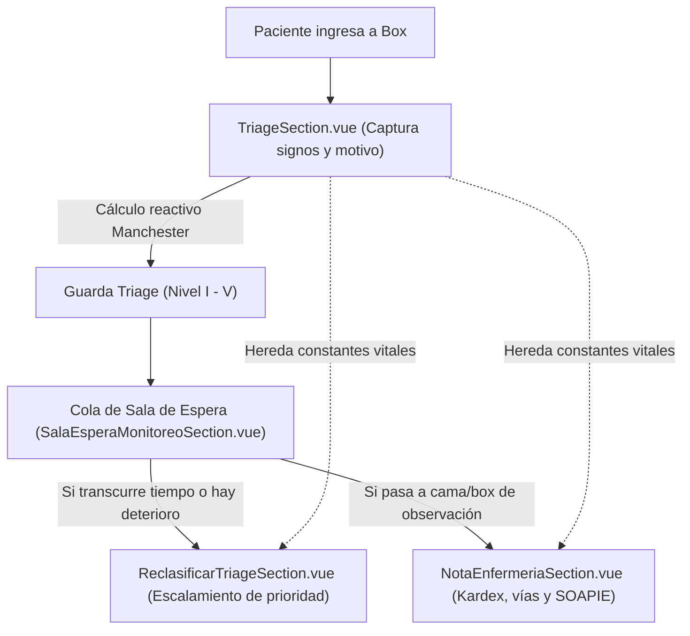

# 👩‍⚕️ Módulo de Enfermería y Triage · Hospital Vitae

## 1. Descripción General
El módulo de **Enfermería y Triage** (`src/views/nurse/`) está diseñado para el personal de enfermería en Box de Triage y salas de hospitalización/urgencias. Se rige por el protocolo internacional **Manchester Triage System (MTS) V4.2** y la **NOM-027-SSA3-2013** (Regulación de los servicios de urgencias y triage).

Incluye captura de signos vitales con telemetría en tiempo real, cálculo reactivo de nivel de severidad (Niveles I al V), reevaluación dinámica por deterioro de espera (SLA), censo dinámico con monitor de sala de espera y la **Hoja de Enfermería con Kardex de Medicación** (NOM-004-SSA3-2012).

---

## 2. Arquitectura de Componentes
Ubicado en `src/views/nurse/`:

```
src/views/nurse/
├── NurseWorkspaceView.vue             # Orquestador del módulo y estado del paciente activo
├── README.md                          # Esta documentación técnica
└── components/
    ├── NurseHeader.vue                # Encabezado institucional, reloj sincronizado y menú de usuario
    ├── NurseSidebar.vue               # Navegación compacta y botón de activación de Choque Inmediato
    ├── TriageSection.vue              # Pantalla 1: Captura de signos iniciales y cálculo Manchester
    ├── ReclasificarTriageSection.vue  # Pantalla 2: Comparativa de telemetría y discriminadores agudos
    ├── SalaEsperaMonitoreoSection.vue # Pantalla 3: Monitor de sala de espera con temporizadores SLA
    └── NotaEnfermeriaSection.vue      # Pantalla 4: Kardex de medicamentos, balance hídrico y SOAPIE
```

---

## 3. Flujo Clínico y Continuidad del Paciente



1. **Captura Inicial (`TriageSection.vue`):**
   * Valora escalas rápidas: **AVDI** (Alerta, Voz, Dolor, Inconsciente) y **EVA** (Escala Visual Analógica del Dolor 0-10).
   * Al registrar el paciente, emite el evento `@guardarTriage` hacia `NurseWorkspaceView.vue`, guardándolo en la cola persistente `pacientesEnEspera`.

2. **Reclasificación Dinámica (`ReclasificarTriageSection.vue`):**
   * Permite evaluar cambios fisiológicos (Delta de signos vitales) mientras el paciente aguarda en sala.
   * Cuenta con el botón **`📋 Copiar previos`** para precargar los signos de ingreso y solo ajustar las constantes que hayan variado.
   * Contiene las 4 preguntas discriminadoras obligatorias del protocolo Manchester (vía aérea, hipoperfusión, dolor isquémico y conciencia).

3. **Monitor de Sala de Espera (`SalaEsperaMonitoreoSection.vue`):**
   * Muestra las tarjetas de pacientes activos en espera con temporizadores en cuenta regresiva.
   * Proporciona accesos de un clic:
     * `🔄 Reclasificar Manchester`: traslada al paciente seleccionado a la pantalla de revaloración.
     * `📝 Nota de Enfermería`: abre de inmediato la hoja clínica y Kardex del paciente.

4. **Nota de Enfermería y Kardex (`NotaEnfermeriaSection.vue`):**
   * **Bloqueo legal de prescripción:** Enfermería administra y da seguimiento, no prescribe diagnósticos médicos nosológicos.
   * Botón **`📥 Heredar de Triage`**: copia los signos vitales tomados en el ingreso sin necesidad de volver a teclearlos.
   * **Kardex con doble chequeo:** confirmación de aplicación con hora de registro para medicamentos orales, IV e infusiones activas.
   * **Balance hídrico:** cálculo automático de diferencia entre ingresos (soluciones/oral) y egresos (diuresis espontánea/vómito).
   * **Narrativa SOAPIE:** estructura clínica estandarizada con inserción de frases rápidas de un clic.

---

## 4. Integración con el Backend (Laravel API v1)

| Funcionalidad | Método | Endpoint Backend | Parámetros Principales |
| :--- | :--- | :--- | :--- |
| **Registrar Triage Inicial** | `POST` | `/api/v1/enfermeria/triage` | `{ nombre, edad, sexo, signos: {...}, avdi, eva, motivo, clasificacion }` |
| **Listar Pacientes en Sala** | `GET` | `/api/v1/enfermeria/sala-espera` | Retorna lista de espera con timestamps para cálculo reactivo de SLA |
| **Confirmar Reclasificación** | `POST` | `/api/v1/enfermeria/reclasificar` | `{ folio, nuevo_nivel, justificacion_clinica, discriminadores: {...} }` |
| **Kardex: Marcar Aplicado** | `POST` | `/api/v1/enfermeria/kardex/aplicar` | `{ medicamento_id, doble_chequeo_nombre, hora_aplicacion }` |
| **Firmar Nota de Enfermería** | `POST` | `/api/v1/enfermeria/notas` | `{ paciente_id, tipo_nota, turno, narrativa_soapie, balance_hidrico }` |

---

## 5. Atajos de Teclado del Módulo de Enfermería
* <kbd>Alt</kbd> + <kbd>S</kbd> : Capturar **Signos Triage Inicial**
* <kbd>Alt</kbd> + <kbd>E</kbd> : Abrir **Nota de Enfermería y Kardex**
* <kbd>Alt</kbd> + <kbd>C</kbd> : Disparar **Protocolo de Choque Inmediato / Reanimación**
* <kbd>Alt</kbd> + <kbd>V</kbd> : Activar **Voceo General de Sala de Espera**
