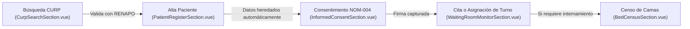

# 📋 Módulo de Recepción y Admisión · Hospital Vitae

## 1. Descripción General
El módulo de **Recepción y Admisión Hospitalaria** (`src/views/reception/`) gestiona la puerta de entrada del paciente al complejo médico: búsqueda y validación de identidad oficial (CURP / RENAPO), registro y alta expedita de pacientes, agendamiento de citas médicas por especialidad, captura de consentimiento informado bajo la **NOM-004-SSA3-2012**, monitor en tiempo real de sala de espera y censo dinámico de camas hospitalarias.

---

## 2. Arquitectura de Componentes
Ubicado en `src/views/reception/`:

```
src/views/reception/
├── ReceptionWorkspaceView.vue         # Orquestador del módulo y persistencia de CURP/paciente
├── README.md                          # Esta documentación técnica
└── components/
    ├── ReceptionHeader.vue            # Encabezado con estado RENAPO, reloj y menú de sesión
    ├── ReceptionSidebar.vue           # Menú lateral rápido, accesos directos y búsqueda rápida
    ├── CurpSearchSection.vue          # Pantalla 1: Consulta oficial de CURP y verificación biométrica
    ├── PatientRegisterSection.vue     # Pantalla 2: Registro maestro de paciente y datos de contacto
    ├── AppointmentBookingSection.vue  # Pantalla 3: Agendamiento de citas por especialidad y médico
    ├── InformedConsentSection.vue     # Pantalla 4: Consentimiento informado NOM-004 y aviso de privacidad
    ├── WaitingRoomMonitorSection.vue  # Pantalla 5: Monitor de sala de espera, voceo y asignación de turno
    └── BedCensusSection.vue           # Pantalla 6: Censo dinámico de camas (Urgencias, UCI, Piso)
```

---

## 3. Continuidad de Datos y Flujo de Admisión
Uno de los principales problemas en sistemas hospitalarios es tener que teclear el CURP o los datos del paciente repetidas veces entre pantallas. En este módulo, el estado se preserva de extremo a extremo en `ReceptionWorkspaceView.vue`:



* **Flujo Legal Único:** El consentimiento informado y aviso de privacidad residen exclusivamente en `InformedConsentSection.vue`, eliminando duplicidades en pantallas de registro y citas.
* Si el paciente ya existe en el sistema, la consulta de CURP precarga inmediatamente su expediente para agendar cita o pasarlo a triage de urgencias.

---

## 4. Integración con el Backend (Laravel API v1)

| Acción de Admisión | Método | Endpoint Backend | Detalles / Payload |
| :--- | :--- | :--- | :--- |
| **Consultar CURP en RENAPO** | `POST` | `/api/v1/renapo/consulta-curp` | `{ curp: "VASM660814HDFRNT08" }` $\rightarrow$ Retorna datos de nacimiento y validez |
| **Registrar Paciente Nuevo** | `POST` | `/api/v1/pacientes` | `{ curp, nombre, apellidos, fecha_nacimiento, genero, telefono, direccion }` |
| **Consultar Disponibilidad Citas** | `GET` | `/api/v1/citas/disponibilidad` | Query params: `?especialidad_id=2&fecha=2026-10-21` |
| **Agendar Cita Médica** | `POST` | `/api/v1/citas` | `{ paciente_id, medico_id, fecha_hora, tipo_consulta, motivo }` |
| **Guardar Consentimiento Firmado** | `POST` | `/api/v1/consentimientos` | `{ paciente_id, tipo_procedimiento, firma_base64, huella_valida: true }` |
| **Censo de Camas en Tiempo Real** | `GET` | `/api/v1/censo/camas` | Retorna lista de camas por piso/área (ocupadas, disponibles, en desinfección) |

---

## 5. Atajos de Teclado del Módulo de Recepción
* <kbd>Alt</kbd> + <kbd>B</kbd> : Búsqueda de **CURP / Paciente**
* <kbd>Alt</kbd> + <kbd>N</kbd> : Formulario de **Nuevo Paciente**
* <kbd>Alt</kbd> + <kbd>A</kbd> : Agendar **Nueva Cita Médica**
* <kbd>Alt</kbd> + <kbd>C</kbd> : Consultar **Censo de Camas Hospitalarias**
* <kbd>Alt</kbd> + <kbd>M</kbd> : Monitor de **Sala de Espera y Turnos**
